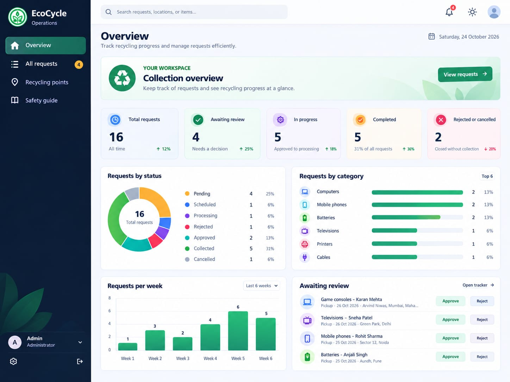

# EcoCycle — E-waste Collection and Recycling

EcoCycle is a browser-based prototype for managing household e-waste collection. People can submit pickup or drop-off requests and follow their status; administrators can review requests and manage their progress. The app also includes an interactive map of possible drop-off locations and a safety guide.



## Features

### For users

- View an overview of your requests and their current statuses.
- Request a home pickup or arrange a drop-off, including category, quantity, date, location, phone, and notes.
- Browse request history and cancel a request while it is pending.
- Find recycling points, electronics shops, and scrap yards on a map; use a result as the location for a drop-off request.
- Browse accepted item categories and read the device preparation and battery safety guidance.

### For administrators

- View request summaries and charts by status, category, and week.
- Review requests, approve or reject them, and update request status.
- Search and filter requests by text, status, or collection method.
- View request details and status history, delete requests, and export filtered results as CSV.

### Map

- Search Indian cities or PIN codes, use the device location, or click the map.
- Search within 5, 10, or 25 km and filter results by place type.
- Map tiles use OpenStreetMap and CARTO. Place lookup uses Nominatim and nearby results use Overpass, with fallback map-tile and Overpass servers.

Map listings are sourced from OpenStreetMap and may be incomplete or outdated. A shop or scrap yard is not a confirmed e-waste collection partner; contact the location to confirm it accepts your items and check its opening hours before visiting.

## Run locally

No package installation or build step is required. From the project directory, start a local web server:

```sh
python3 -m http.server 8000
```

Then open <http://localhost:8000> in a browser. You can also open `index.html` directly, but a local server is recommended. An internet connection is needed for map tiles and place searches. Browser geolocation is generally available only on HTTPS pages or localhost.

## Try the prototype

1. On the sign-in screen, choose **Fill user** or **Fill administrator**.
2. Enter any password of at least six characters and sign in.
3. As a user, create a pickup or drop-off request and view it in **My requests**. As an administrator, review and manage requests in **All requests**.

You can also create a prototype account with a name and any valid email address. This is simulated access, not real account registration: there is no credential verification, and anyone can select the administrator role.

## Data and security

- Requests, the signed-in prototype profile, and the selected theme are stored in the browser's local storage on the current device. There is no server, shared database, or synchronization between browsers.
- The app starts with sample requests when no saved request data is available. Changes made in the prototype affect only that browser's local data.
- Sign-in and role selection are not secure. Do not use real credentials or sensitive personal information. A production deployment needs server-side authentication and authorization, input validation, and an API.
- Map searches send the entered place name or coordinates to the public Nominatim and Overpass services. These services have usage limits; production traffic should use appropriately configured, self-managed services or a compliant proxy and cache.
- The included MySQL script is a separate schema/sample-data artifact. The browser app does not connect to it.

## MySQL schema (optional)

`DATABASE.sql` creates the `ewaste_management` database, defines the users, admins, categories, requests, collections, recycling records, and recovered-material tables, and inserts sample data. To load it with the MySQL command-line client:

```sh
mysql -u your_mysql_user -p < DATABASE.sql
```

This prepares the database only; it does not connect the web app to MySQL.

## Project files

| File or folder | Purpose |
| --- | --- |
| `index.html` | App structure, forms, and views |
| `app.js` | Client-side interactions, request state, storage, and map behavior |
| `styles.css` | Layout, components, and light/dark themes |
| `vendor/leaflet/` | Locally bundled Leaflet map library and assets |
| `fonts/` | Locally bundled IBM Plex Sans fonts and license |
| `Assest/` | App logo and favicon |
| `DATABASE.sql` | Standalone MySQL schema and sample data |
| `ER MODEL.png` | Database entity-relationship diagram |
| `ui.jpeg` | Dashboard preview |

Map data © [OpenStreetMap contributors](https://www.openstreetmap.org/copyright). Map tiles may also be provided by [CARTO](https://carto.com/attributions).
