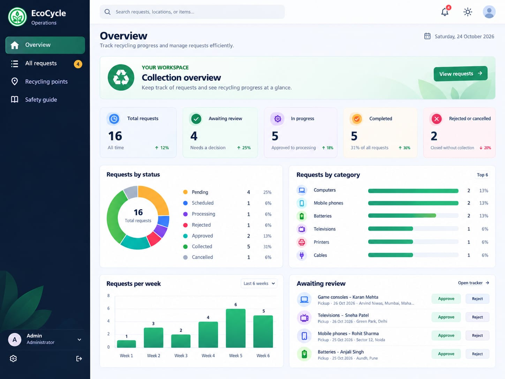

# EcoCycle — E-waste Collection, Circular Recycling & Sustainability Platform

EcoCycle is an end-to-end full-stack web application for managing household and enterprise e-waste collection, circular recycling, and environmental impact recovery.



---

## 🚀 Quick Start

### 1. Requirements
- **Node.js**: v18 or higher (Node v24 tested)
- **MongoDB**: Local MongoDB instance (`mongodb://127.0.0.1:27017/ecocycle`) or a free [MongoDB Atlas](https://www.mongodb.com/atlas) cluster URI.

### 2. Configure Environment
A default `.env` file is included. Customize `MONGODB_URI` or `PORT` if needed:
```env
PORT=5000
MONGODB_URI=mongodb://127.0.0.1:27017/ecocycle
JWT_SECRET=ecocycle_jwt_secure_secret_key_2026_super_safe
```

### 3. Run the Backend & Web App
```bash
# Start backend server + static UI
npm start

# Or with live reload in development
npm run dev
```
Open **`http://localhost:5000`** in your browser.

### 4. Seed MongoDB Database (Optional)
To populate MongoDB with verified recycling centers, waste categories, sample requests, and demo accounts:
```bash
npm run seed
```

---

## 🔑 Demo Accounts

| Role | Email | Password | Access Scope |
| --- | --- | --- | --- |
| **Regular User** | `rahul@example.com` | `demo1234` | Submit collection requests, track history, map finder |
| **User (Sample 2)** | `priya@example.com` | `demo1234` | Submit collection requests, track history |
| **Administrator** | `admin@example.com` | `demo1234` | Approve/reject requests, manage pipeline, CSV export, analytics |

*New registrations are created as standard users with bcrypt hashed credentials.*

---

## 🛠️ Architecture & Stack

### Backend
- **Runtime**: Node.js
- **Framework**: Express 5
- **Database**: MongoDB using Mongoose ODM (`models/`)
  - `User`: Accounts, role-based access, bcrypt password hashing
  - `CollectionRequest`: E-waste requests with audit status history and weights
  - `WasteCategory`: E-waste categories, preparation guidelines, average unit weights
  - `RecyclingCenter`: Certified drop-off hubs with geographic coordinates
  - `RecyclingRecord`: Post-collection material recovery and CO₂ savings metrics
- **Security & Auth**: JWT (JSON Web Tokens) with `Bearer` header authentication, bcryptjs password hashing.
- **Resilient Fallback**: If MongoDB is starting or running offline, the server provides an instant in-memory fallback layer so development and testing are never interrupted.

### Frontend & Enhanced UI
- **Eco-Impact Sustainability Tracker**: Real-time CO₂ emissions offset (kg), total e-waste diverted, and precious metals (Copper, Aluminum, Gold) recovered.
- **Collection Pipeline Funnel**: Visual 6-stage tracker (`Pending` ➔ `Approved` ➔ `Scheduled` ➔ `Collected` ➔ `Processing` ➔ `Completed`) with click-to-filter capability.
- **Filter Tabs**: Instant filtering by status (`All`, `Pending Review`, `In Progress`, `Completed`, `Cancelled`) with live badge counters.
- **Interactive Impact Estimator**: Live dynamic calculator on the request form estimating total weight, carbon savings, and recoverable metals as categories and quantities change.
- **Category Guidance Banner**: Contextual safety alerts (e.g. battery handling, data erasure for laptops and phones).
- **Interactive Map**: Certified partner badges, one-click "Use for drop-off request", and direct navigation links.
- **Live Backend Connection Indicator**: Topbar pill displaying live MongoDB connectivity state.

---

## 📡 REST API Reference

### Authentication (`/api/auth`)
- `POST /api/auth/register` — Create a new user account (returns JWT token + profile)
- `POST /api/auth/login` — Sign in with email, password, and role
- `GET /api/auth/session` — Fetch authenticated session profile
- `POST /api/auth/logout` — Invalidate session

### Collection Requests (`/api/requests`)
- `GET /api/requests` — List collection requests (user sees own; admin sees all; supports `?status=`, `?method=`, `?search=`)
- `POST /api/requests` — Submit a new pickup or drop-off collection request
- `GET /api/requests/:id` — Get request details and complete status history
- `PATCH /api/requests/:id/status` — Update status (`Pending`, `Approved`, `Scheduled`, `Collected`, `Processing`, `Completed`, `Rejected`, `Cancelled`)
- `DELETE /api/requests/:id` — Delete a request (admin only)

### Master Data & Analytics
- `GET /api/categories` — List accepted e-waste categories and handling instructions
- `GET /api/centers` — List verified recycling and drop-off hubs
- `GET /api/stats` — Overall statistics, sustainability calculations, and category breakdowns
- `GET /api/health` — Service health check and MongoDB connection status

---

## 📁 Project Structure

```
├── Assest/                 # Logo and brand images
├── fonts/                  # Locally bundled IBM Plex Sans typography
├── middleware/
│   ├── auth.js             # JWT authentication & requireAdmin middleware
│   └── errorHandler.js     # Uniform API error responses
├── models/
│   ├── CollectionRequest.js # Mongoose schema for collection requests & history
│   ├── RecyclingCenter.js   # Mongoose schema for drop-off centers
│   ├── RecyclingRecord.js   # Mongoose schema for recycling records & materials
│   ├── User.js              # Mongoose schema for users & admins
│   └── WasteCategory.js     # Mongoose schema for categories & impact factors
├── routes/
│   ├── auth.js             # Authentication routes (login, register, session)
│   ├── categories.js       # E-waste categories route
│   ├── centers.js          # Recycling centers route
│   ├── requests.js         # Collection request CRUD routes
│   └── stats.js            # Sustainability & analytics statistics route
├── scripts/
│   └── seed.js             # MongoDB seeder script
├── vendor/leaflet/         # Locally bundled Leaflet map engine
├── .env                    # Environment variables (PORT, MONGODB_URI, JWT_SECRET)
├── app.js                  # Frontend application controller & hybrid API client
├── DATABASE.sql            # Original reference SQL schema
├── index.html              # Enhanced application layout & views
├── package.json            # Node.js project manifest & npm scripts
├── server.js               # Express 5 server & MongoDB connection manager
└── styles.css              # Enhanced CSS styling, themes, and animations
```
